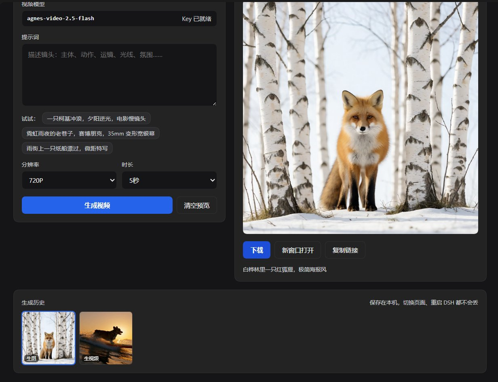
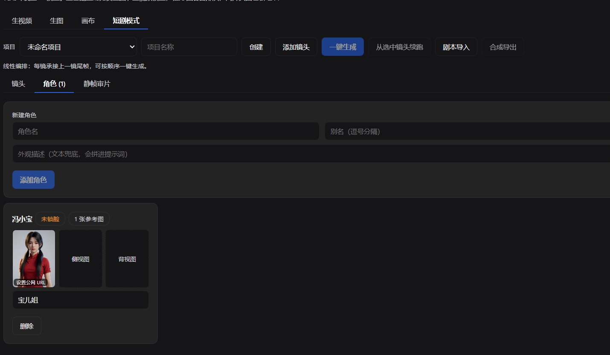

# dsh-agnes-media · Agnes 创作室

**在 DeepSeek Harness 侧边栏里生图、生视频，还能按分镜把一集短剧串起来。任务跑在宿主进程，关掉页面也不中断。**

[](LICENSE)
[](https://github.com/deepseek-ai)
[](https://nodejs.org)



---

## 安装

**从插件市场安装**（推荐）

DeepSeek Harness →「设置 → 插件市场」→ 搜索 `dsh-agnes-media` → 一键安装。

**从 npm 安装**

```bash
dsh plugin add dsh-agnes-media
```

**从 GitHub 安装**（跟进最新提交）

```bash
dsh plugin add github:zzsszz1122/dsh-agnes-media
```

> 桌面版请在应用内「设置 → 插件」里安装；CLI 在应用运行时不会改动桌面版的 profile。

安装后在「设置 → 插件」确认 `dsh-agnes-media` 已启用，左侧栏即出现「Agnes 创作室」图标。

---

## 它解决什么问题

DeepSeek Harness 的模型调用统一走 `POST /v1/chat/completions`，而 Agnes 的媒体模型在另外两个端点上：

| 能力 | 端点 |
|---|---|
| 生图 | `POST /v1/images/generations` |
| 生视频 | `POST /v1/videos` 提交，再轮询 `GET /v1/videos/{id}` |

这些端点不在 chat 协议里。本插件由**宿主进程**直接调用它们，并把结果落盘——浏览器全程接触不到 API Key。

---

## 界面

左侧栏独立入口，顶部四个页签：

| 页签 | 用途 |
|---|---|
| **生视频** | 提示词 + 分辨率 + 时长 + 种子，单条生成 |
| **生图** | 提示词 + 尺寸 + 种子，单条生成 |
| **画布** | 节点图：拖拽排版、滚轮缩放、空白处拖拽平移，自动保存；支持从资源管理器**直接拖入视频/图片**作为素材节点 |
| **短剧模式** | 含三个子页签：**镜头**（分镜表与提示词编辑，右键镜头可删除）、**角色**（人物三视图与锁脸状态）、**静帧审片**（整集静帧网格审核）；顶部工具栏可删除整个项目 |

结果区支持预览、下载（宿主接口支持 `Range` 拖动）、新窗口打开、复制链接；生成历史缩略图常驻，可单条删除。

---

## 特性

### 后台任务，离开页面不丢

- 提交后立即返回任务；宿主在后台提交上游、每 6 秒轮询进度。
- 上游忙碌时对 `429` / `5xx` 退避重试，面板显示重试次数。
- 切换面板、刷新页面、关闭标签页都不影响任务；Host 重启后，「排队中 / 生成中」的任务自动恢复轮询。
- 单任务最长等待 **40 分钟**（`TASK_DEADLINE_MS`），超时记为失败，可重新提交。
- 每个界面都有取消入口，取消会在宿主侧真正停掉轮询与退避循环。

### 生成能力

| | 参数 |
|---|---|
| 生图 | 7 种尺寸：`1024×1024`、`1024×768`、`768×1024`、`1280×720`、`720×1280`、`1536×1536`、`2048×2048` |
| 生视频 | 分辨率 `720P` / `1080P`；时长 `4 / 5 / 6 / 8 / 10 / 12` 秒 |
| 通用 | 提示词最多 4000 字符，支持固定 seed 复现 |

### 短剧模式

- **集 / 场 / 镜头**线性编排，镜头列表 + 提示词 / 时长 / 镜头语言编辑 + 时间线总时长。
- **剧本导入**：粘贴纯文本剧本（`第X集`、`EP`、`场…`、`1.` 等标记），按规则确定性地拆成集 / 场 / 镜头草稿，不调用大模型，导入后可在分镜表逐条改。
- **一键生成**：按顺序串行执行，单并发、单项目互斥，可从任一镜续跑，已完成的镜头不会重跑。
- **合成导出**：把已完成镜头用 ffmpeg 归一化并拼成一集 mp4（仅当每段都带音轨时才混音），面板内预览、下载。
- **失败隔离**：单镜失败只标记该镜并记入 `chain.failures`，不拖垮整条链路。

### 长时长与画布素材

- **时长**：可选 5 / 10 / 15 / 20 / 25 / 30 秒（5 的倍数）。上游单次最多 12 秒，超过的部分按**均分**拆段（15→8+7、20→10+10、30→10+10+10），每段抽尾帧作为下一段首帧，最后用 ffmpeg 拼成单个文件，接缝处画面连续。
- **拖入素材**：把视频或图片从文件资源管理器拖到画布，会存到 `projects/<pid>/assets/imports/` 并生成一个素材节点，视频可直接在节点里播放（支持 `Range` 拖动）。

### 人物一致性

短剧最容易出废案的地方是「同一个人换了张脸」。本插件用三层手段压住这件事，按优先级生效：

**1. 角色库（三视图）**

每个角色有名字、别名、外观文本，以及正 / 侧 / 背 / 额外（`front` / `side` / `back` / `extra`）四类参考图。参考图存在项目目录里，可为每张填一个**公网 HTTPS 地址**——只有公网地址才能被上游参考模式消费。



上图是「短剧模式 → 角色」页签：正面图已上传、侧背两面待补，卡片上标着「未锁脸」——因为还没填公网 URL。

**2. 参考模式锁脸**

视频请求按优先级选模式：

| 优先级 | 条件 | 请求 |
|---|---|---|
| 1 | 本镜出场角色有公网参考图 | `mode: reference` + `reference_image_urls`（最多 4 张） |
| 2 | 本镜有首帧 | `mode: keyframe` + `first_frame`（base64） |
| 3 | 都没有 | `mode: text` |

每镜记录 `lockMode`，未锁脸时界面明确标注，不静默降级。参考模式被 4xx 拒绝（通常是 URL 不可达或不支持）时，自动摘掉参考图降级一次，并把原因写进任务备注。

**出场角色怎么确定**：镜头里显式勾选的角色，加上按角色名字 / 别名在提示词中自动匹配到的角色。

**3. 先静帧后视频**

每镜可先生成静帧（图片几秒、便宜），在「静帧审片」里逐张通过 / 打回 / 重生成。**通过的静帧直接成为该镜首帧**，之后才花视频的钱。人脸不对在这一步就暴露，成本差一个量级。

**生成前门禁**

链路启动前检查每一镜：

- **只拦真正要锁脸的镜头**——出场角色解析结果为空（纯空镜）时永不拦截。
- 满足任一即放行：有公网参考图 / 有已批准静帧 / 能接上一镜尾帧。
- 全都不满足 → 直接拒绝启动，并列出「第 N 镜要锁 XX 的脸，但该角色还没有公网参考图」。

确实想不锁脸硬跑时，可带 `skipPreflight` 绕过。

### 尾帧接首帧

上游完成后由宿主用 ffmpeg 抽尾帧，下一镜以 `mode: keyframe` + `first_frame`（base64）提交。需要本机安装 ffmpeg（或设置 `AGNES_FFMPEG` / 插件 `config.ffmpegPath`）。缺失时界面提示「ffmpeg 未安装」，下游镜头标记为阻塞而不是静默降级。

> **画布连线只是标注。** 节点之间的连线用于可视化「谁接谁」，实际执行顺序由分镜表（镜头数组）决定，改连线不会改变生成顺序或衔接关系。

---

## 本地存储

- 结果与索引：`<DSH 主目录>/agnes-media/`（`history.json` + `media/`）。
- 项目数据：`agnes-media/projects/<projectId>/`
  - `project.json`（含 `bible` 风格 / 角色 / 场景与 `chain` 状态）
  - `shots/*.json`、`canvas.json`
  - `assets/frames/`（首帧与尾帧）、`assets/cast/<角色>/`（三视图）、`assets/storyboard/`（静帧）
- 历史保留最近 **80** 条，超出自动清理最旧记录；单个结果文件上限 512MB。
- 不上传任何第三方。

---

## 和 `LittleBeaverStudio/agnes-media` 的区别

同一个模型、同一个宿主，交互方式不同，两者可以并存：

| | 本项目 | `LittleBeaverStudio/agnes-media` |
|---|---|---|
| 使用方式 | **人**在侧边栏面板操作 | **模型**在对话中调用 `generate_image` / `generate_video` 工具 |
| 任务生命周期 | 宿主后台执行，关页面不中断 | 随对话请求完成 |
| 历史记录 | 本地落盘，80 条，可回看 | 无 |
| 分镜与合成 | 短剧模式 + 剧本导入 + ffmpeg 合成 | 无 |
| 人物锁脸 | 角色三视图 + `reference` 模式 + 静帧审核 | `reference_image_urls` 工具参数 |
| 输出形态 | 文件存本地，可预览 / 下载 | 返回结果链接 |

简单说：**要 AI 自己在对话里画，用那个；要排一集短剧、盯住同一张脸，用这个。**

---

## 配置

插件读取「设置 → 模型」里 `agnes` 这条 provider 的凭据引用（默认 `apiKeyEnv: AGNES_API_KEY`），模型默认取该 provider 已声明的那两个：

- 视频：`agnes-video-2.5-flash`
- 图像：`agnes-image-2.5-flash`

模型名里的下划线会归一化为连字符（`agnes_video_2.5_flash` → `agnes-video-2.5-flash`）。

接口地址默认 `https://api.agnes-ai.cn/v1`。要改，在这条插件行的 `config` 里覆盖：

```yaml
- id: dsh-agnes-media
  config:
    baseURL: https://api.agnes-ai.cn/v1
    apiKeyEnv: AGNES_API_KEY
    videoModel: agnes-video-2.5-flash
    imageModel: agnes-image-2.5-flash
    ffmpegPath: '' # 可选；留空依次尝试 AGNES_FFMPEG 与 PATH
```

---

## 宿主接口

所有路由挂在 `/agnes-media/api` 前缀下，由宿主进程提供，需要已登录的 DSH Web 会话。

**任务与历史**

| 方法 | 路径 | 作用 |
|---|---|---|
| GET | `/status` | Key 状态、接口地址、模型名、ffmpeg 可用性 |
| GET | `/history` | 生成历史（含状态、进度、重试提示） |
| GET | `/task/:id` | 单个任务状态 |
| POST | `/task/:id/cancel` | 取消单个任务 |
| POST | `/image` | 创建生图任务 |
| POST | `/video` | 创建生视频任务 |
| POST | `/history/delete` | 删除一条历史及其文件 |
| GET | `/media/:id?download=1` | 结果文件，支持 `HEAD` 与 `Range` |

**项目 / 镜头 / 画布**

| 方法 | 路径 | 作用 |
|---|---|---|
| GET/POST | `/projects` | 项目列表 / 新建 |
| GET/PATCH/DELETE | `/projects/:id` | 项目详情 / 更新 / 删除 |
| GET · PUT | `/projects/:id/canvas` | 读取 / 保存画布节点、连线、视口 |
| GET/POST | `/projects/:id/shots` | 镜头列表 / 新建 |
| PATCH/DELETE | `/projects/:id/shots/:sid` | 更新 / 删除镜头 |
| POST | `/projects/:id/shots/:sid/first-frame` | 上传手动首帧（base64） |
| GET | `/projects/:id/shots/:sid/tail` | 读取该镜尾帧（jpg） |
| GET | `/projects/:id/timeline` | 时间线与总时长 |

**链路 / 剧本 / 合成**

| 方法 | 路径 | 作用 |
|---|---|---|
| POST | `/projects/:id/chain` | 顺序执行（`{shotIds?, from?, force?, skipPreflight?}`） |
| POST | `/projects/:id/chain/cancel` | 取消整条链路并中断当前任务 |
| POST | `/projects/:id/script/parse` | 解析剧本生成分镜（`{text, replace?}`） |
| POST | `/projects/:id/assemble` | ffmpeg 合成导出成片 |
| GET | `/projects/:id/episode/:file?download=1` | 预览 / 下载合成结果 |
| POST | `/projects/:id/imports` | 上传画布素材（base64，mp4/mov/webm/png/jpeg/webp，上限 200MB） |
| GET/HEAD | `/projects/:id/imports/:assetId` | 读取导入素材，支持 `Range`（视频可拖动进度） |

**角色与静帧**

| 方法 | 路径 | 作用 |
|---|---|---|
| GET/POST | `/projects/:id/cast` | 角色列表 / 新建角色 |
| PATCH/DELETE | `/projects/:id/cast/:cid` | 改名 / 别名 / 外观 / 删除 |
| POST | `/projects/:id/cast/:cid/refs` | 上传三视图（base64 + `kind`） |
| PATCH | `/projects/:id/cast/:cid/refs/:rid` | 设置参考图公网 URL（参考模式必需） |
| GET | `/projects/:id/cast/:cid/refs/:rid/file` | 读取参考图 |
| POST | `/projects/:id/shots/:sid/storyboard` | 生成该镜静帧 |
| GET | `/projects/:id/shots/:sid/storyboard` | 读取静帧 |
| POST | `/projects/:id/shots/:sid/approve` | 通过静帧 → 成为首帧 |
| POST | `/projects/:id/shots/:sid/reject` | 打回静帧 |

---

## 兼容性

- DeepSeek Harness **0.2.1-rc.3** 实测通过，最低版本由 `package.json` 的 `engines.dsh` 声明。
- Node.js **≥ 20**（依赖全局 `fetch` 与 `AbortSignal.timeout`）。
- **ffmpeg** 用于抽尾帧与合成导出；缺失时静帧、单条生成、编辑等功能不受影响。
- 客户端只使用宿主注入的 `react` 与 `slots` / `locale` 服务，不额外打包前端依赖，零运行时依赖。

---

## 安全

- API Key 只在宿主进程内经 DSH 凭据服务解析，浏览器从不接触明文。
- 宿主代理只接受固定请求体字段；`/media/:id` 只回传本插件自己生成并登记在历史里的文件，无法读取任意路径。
- 三视图、静帧、生成结果全部留在本机；只有你显式填入的**公网 URL** 会随参考模式发给上游。
- 本插件非 Agnes 或 DeepSeek 官方产品，仅调用你已配置的 API。

---

## 常见问题

**左侧栏没有出现图标**
「设置 → 插件」里确认 `dsh-agnes-media` 处于启用状态；宿主代码变更需重启 DSH 才生效。

**提示未配置 Key**
先在「设置 → 模型」里为 `agnes` 这条 provider 填好 `AGNES_API_KEY`。

**上游 HTTP 401：无效的令牌**

出现这条说明请求**已经到达 Agnes**（错误里带 request id），是上游拒绝了这个令牌——不是网络问题，也不是插件没读到 Key（读不到会提示「未配置 Key」）。按下面顺序自查：

1. **确认插件用的是哪个令牌。** 面板顶部状态条会显示令牌指纹（如 `sk-a…f9k2（长度 32）`）、来源与上游地址；也可以直接访问 `/agnes-media/api/status` 看 `keyHint` / `source` / `baseURL`。拿指纹和 Agnes 控制台里的 Key 对一下，就能判断是不是用错了那把。
2. **令牌来源被环境变量抢占。** 解析顺序是：`设置 → 模型` 里的 `AGNES_API_KEY` 凭据 → 系统环境变量 `AGNES_API_KEY` → DSH 凭据记录 `agnes-api-key`。如果机器上残留了一个旧的环境变量，而 `status.source` 显示 `env`，就是它在生效。
3. **令牌属于另一个 Agnes 站点。** 插件默认打到 `https://api.agnes-ai.cn/v1`。若你的账号在别的域名/镜像下注册，Key 本身有效但对不上这个地址，就会 401。在插件行 `config` 里覆盖 `baseURL` 即可（见「配置」）。
4. **复制时带了多余字符。** 末尾换行、包裹的引号、或连 `Bearer ` 一起粘贴，都会让上游判为无效令牌。**0.7.1 起插件会自动清理**这些字符再发送；若清理过，状态条下方会给出提示。
5. 以上都排除，就是这把 Key 被吊销、过期，或没有开通视频/图像接口权限。

**任务一直显示排队中**
上游队列繁忙，插件会对 `429` / `5xx` 自动退避重试并显示次数；超过 40 分钟记为失败，可重新提交。

**改了代码没反应**
`client.js` 属前端，刷新页面即可；`index.js` 与 `lib/` 属宿主，必须重启 DSH。

**界面提示「ffmpeg 未安装」**
装 ffmpeg 并加入 PATH，或设 `AGNES_FFMPEG`，或在插件行 `config` 里写 `ffmpegPath`。装完要重启 DSH——宿主每个进程只解析一次。

**人物还是不像 / 提示「未锁脸」**
参考模式只认**公网 HTTPS** 图片地址，本地文件不会被提交。给角色三视图填一个可公网访问的 URL，或者改用「先静帧后视频」——把静帧改到满意再生成视频。

**链路被拒绝启动**
门禁发现某镜要锁脸但既没有公网参考图、也没有已批准静帧、也没有上一镜尾帧。按提示补齐即可；确需硬跑可在请求里带 `skipPreflight`。

**参考模式被降级**
上游拒绝了参考图（多为 URL 不可达）。任务备注里会写明降级原因，该镜回退到首帧或纯文本模式。

---

## 已知限制

- **参考模式需要公网 HTTPS 参考图**：本地三视图只存在项目目录里，不经托管无法被上游消费；data URI 是否被接受尚未验证。
- 链路串行执行（单并发），一个项目同时只允许一条链路。
- 单任务最长 40 分钟；历史最多 80 条，超出的最旧记录连同文件一起删除。
- 画布连线是可视化标注，不参与执行顺序；画布暂不支持框选、多选与分组。
- 剧本解析是规则式的：极端格式（如整段无编号的对白）需要导入后在分镜表手工整理。

---

## 更新日志

各版本变更见 [CHANGELOG.md](CHANGELOG.md)。

---

## 许可证

[MIT](LICENSE) · 非官方插件，与 Agnes、DeepSeek 无隶属关系。
